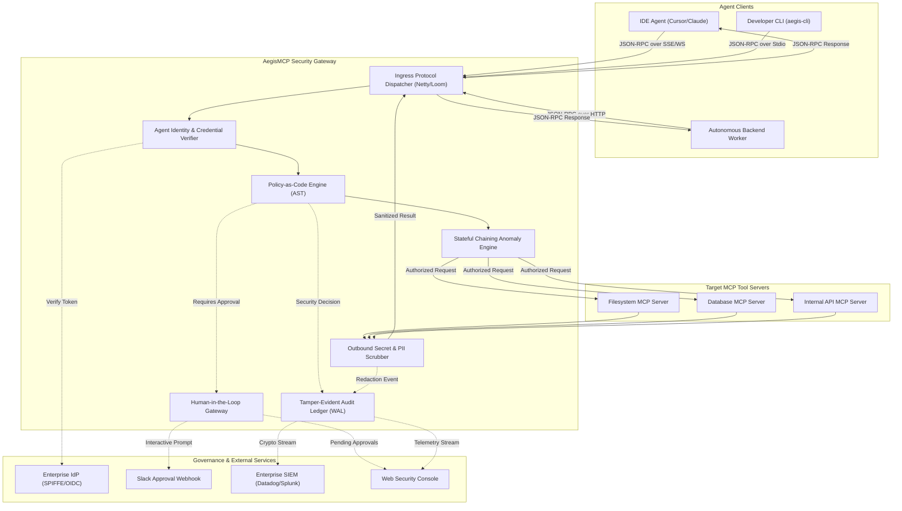

# System Architecture

## Architecture Overview

**Interfaces:** API/Service, CLI, Web
**Architecture Style:** Hybrid (High-performance streaming reverse proxy engine + distributed sidecar/control plane + Web management console)
**Primary Client:** AI Agents (IDE assistants, autonomous backend workers) connecting over JSON-RPC 2.0; Administrators on Web Single Page Application (SPA)
**Hosting Model:** Cloud-native Kubernetes sidecar / Ingress Gateway / Self-hosted Linux container

AegisMCP is structured around a non-blocking, zero-copy protocol proxy engine built in modern Java 21 using Virtual Threads (Project Loom). It sits directly inline between AI agent hosts and Model Context Protocol (MCP) tool servers. The architecture isolates security policy evaluation, stateful sequence anomaly detection, data loss prevention (DLP), and cryptographic audit logging from underlying transport protocols, delivering sub-5ms P99 latency overhead ([NFR-001](nfr.md)) under high-concurrency workloads.

---

## System Components

### Component: Ingress Transport & Protocol Dispatcher
**Responsibility:** Intercepts client connections, decodes JSON-RPC 2.0 streaming messages across HTTP/SSE, WebSocket, and Stdio transports, and manages client connection lifecycles.
**Provides:** Framed JSON-RPC request and response streaming pipelines with bidirectional connection handling.
**Consumes:** Agent Identity Module, Policy Evaluation Engine.
**Platform Notes:** Implemented with Java 21 Virtual Threads and non-blocking I/O buffers, allowing each active agent stream to execute concurrently with minimal memory footprint ([NFR-001](nfr.md)).

### Component: Agent Identity & Credential Verifier
**Responsibility:** Authenticates incoming agent connections and validates cryptographic identity credentials.
**Provides:** Verified agent identity context (SPIFFE ID, OIDC claims, service account) bound to the active session.
**Consumes:** Enterprise Identity Provider (IdP) / SPIFFE Workload API ([FEAT-009](features/FEAT-009.md)).
**Platform Notes:** Enforces mutual TLS (mTLS) with x509 SVID validation in Kubernetes environments ([NFR-020](nfr.md)).

### Component: Policy-as-Code Evaluation Engine
**Responsibility:** Evaluates incoming `tools/call` and `resources/read` invocations against active declarative security policies with sub-millisecond latency.
**Provides:** Deterministic Allow / Block / Require-Approval authorization decisions.
**Consumes:** Policy Storage & In-Memory Cache, Tool Parameter Schema Validator ([FEAT-002](features/FEAT-002.md)).
**Platform Notes:** Evaluates pre-compiled abstract syntax trees (AST) in memory to achieve sub-millisecond evaluation ([NFR-001](nfr.md)).

### Component: Stateful Chaining Anomaly Engine
**Responsibility:** Tracks multi-step tool execution sequences across an agent session to detect and intercept data exfiltration sequences.
**Provides:** Behavioral anomaly flags, session quarantine signals ([FEAT-004](features/FEAT-004.md)).
**Consumes:** In-memory session state machine ([NFR-003](nfr.md)).
**Platform Notes:** Maintains rolling sliding-window session state across concurrent agent threads using thread-safe state representations.

### Component: Outbound Secret & PII Scrubber (DLP)
**Responsibility:** Scans upstream tool response payloads in real time, redacting credentials and personal data before returning results to agents.
**Provides:** Sanitized tool execution results ([FEAT-005](features/FEAT-005.md)).
**Consumes:** Aho-Corasick pattern dictionary, regex rule engine ([NFR-025](nfr.md)).
**Platform Notes:** Operates on streaming chunks to avoid loading large payloads into Java heap memory.

### Component: Human-in-the-Loop (HITL) Approval Gateway
**Responsibility:** Holds high-impact tool invocations in suspense, dispatching interactive approval tickets and resuming execution upon authorization.
**Provides:** Out-of-band human authorization orchestration ([FEAT-006](features/FEAT-006.md)).
**Consumes:** External notification webhooks (Slack, email), Web Console approval APIs.
**Platform Notes:** Implements timeout-bounded async completion (`CompletableFuture`) with automatic 5-minute fail-closed expiration.

### Component: Tamper-Evident Audit Ledger
**Responsibility:** Appends immutable, cryptographically hash-chained event records for all intercepted tool invocations and administrative actions.
**Provides:** Cryptographic audit trails, integrity verification proofs, SIEM log streaming ([FEAT-007](features/FEAT-007.md)).
**Consumes:** Local write-ahead log (WAL) on persistent volume ([NFR-026](nfr.md)).
**Platform Notes:** Computes SHA-256 hash chaining asynchronously via dedicated virtual thread workers without blocking proxy response paths.

### Component: Web Admin Console & Live Traffic Inspector
**Responsibility:** Delivers a browser-based management interface for real-time traffic monitoring, human approvals, and audit log analysis.
**Provides:** Visual security dashboard, live SSE traffic stream, approval action controls ([FEAT-008](features/FEAT-008.md)).
**Consumes:** Ingress Protocol Dispatcher (telemetry stream), Audit Ledger, Policy Engine.
**Platform Notes:** Built as a responsive SPA adhering to the design tokens and accessibility standards defined in [branding](branding.md).

### Component: Local Developer CLI (`aegis-cli`)
**Responsibility:** Provides a local command-line wrapper and debugger for developer workstations.
**Provides:** Local stdio process interception, interactive terminal logs, policy linting ([FEAT-003](features/FEAT-003.md)).
**Consumes:** Core policy evaluation and redaction libraries.
**Platform Notes:** Distributed as a lightweight native binary or container for Linux and macOS workstations.

---

## Data Architecture

### Data Stores

| Store | Type | What It Holds | Access Pattern |
|---|---|---|---|
| Policy Cache & Session State | In-Memory (Java Concurrent Hash Maps) | Compiled policy rules, active session sequences, rate limit counters | Microsecond reads on every tool call, TTL-based session eviction |
| Tamper-Evident Audit Ledger | Append-Only Disk Store (WAL) | Cryptographically linked JSON audit records, hash chains, digital signatures | Sequential append-only writes, sequential range reads for audits |
| Central Policy Repository | GitOps / Relational Database | Version-controlled YAML policies, tool whitelist catalogs, RBAC assignments | Read on startup and dynamic reload on configuration change |

### Data Flow Patterns

- **Synchronous Fast Path:** Agent Client → Ingress Transport → Identity Verification → Policy Evaluation Engine → Upstream MCP Server → Outbound DLP Scrubber → Agent Client. Enforces strict sub-5ms P99 latency budget ([NFR-001](nfr.md)).
- **Asynchronous Telemetry Path:** Completed tool call events are dispatched non-blockingly to the Tamper-Evident Audit Ledger and streamed to the Web Console Live Inspector via Server-Sent Events ([NFR-004](nfr.md), [NFR-005](nfr.md)).
- **Suspended Approval Path:** Sensitive tool call matched → Gateway generates approval token and suspends agent transport socket → Dispatches webhook to Slack/Web Console → Awaits human decision → On "Approve", releases tool call upstream; on "Reject" or timeout, returns error.

---

## External Integrations

| Service | Purpose | Direction | Criticality |
|---|---|---|---|
| Upstream MCP Tool Servers | Backend servers hosting executable tools (filesystem, DB, shell, APIs) | Inbound / Outbound | High |
| Enterprise Identity Provider (IdP) | Validates agent service tokens (OIDC, OAuth 2.0, SPIFFE Workload API) | Inbound (Auth verification) | High |
| Slack / Teams Webhook API | Delivers real-time Human-in-the-Loop approval requests to security personnel | Outbound (Notifications) | Medium |
| Enterprise SIEM / OpenTelemetry | Streams audit records and security telemetry to centralized log aggregators | Outbound (Log streaming) | Medium |

---

## Deployment Topology

### Environments

| Environment | Purpose | Data |
|---|---|---|
| Development | Local developer testing and debugging using `aegis-cli` | Synthetic mock tool requests, local filesystem |
| Staging | Pre-release validation and integration testing in non-production Kubernetes clusters | Anonymized staging database tools, test agent sessions |
| Production | Live production proxy securing enterprise agent workloads | Production enterprise data, strict audit retention policies |

### Deployment Modes
1. **Sidecar Mode (Default for Kubernetes):** AegisMCP is deployed as a sidecar container within the same Kubernetes pod as the autonomous agent. All agent outbound traffic to `localhost` MCP ports is redirected through the sidecar proxy.
2. **Central Ingress Gateway Mode:** AegisMCP runs as a scalable multi-node cluster behind a network load balancer, fronting shared enterprise MCP tool servers.
3. **Local Standalone Mode:** Developers run `aegis-cli wrap` directly on their local machines to wrap local MCP child processes.

### Scaling Strategy
Stateless proxy nodes scale horizontally via Kubernetes Horizontal Pod Autoscaler (HPA) triggered when CPU utilization exceeds 70% or active concurrent sessions exceed 40,000 per node ([NFR-001](nfr.md)). Session sequence state is localized per active agent connection or synchronized via Redis for multi-instance clusters.

---

## Cross-Cutting Concerns

**Authentication & Authorization:** Agents must present valid cryptographic credentials (SPIFFE/SPIRE SVID or OIDC Bearer token) upon connection establishment ([NFR-020](nfr.md)). Access control is strictly fail-closed ([NFR-027](nfr.md)).
**Error Handling:** In line with the JSON-RPC 2.0 specification, policy rejections, syntax errors, and upstream timeouts return standardized error payloads (`-32600 Invalid Request`, `-32001 Policy Violation`, `-32002 Approval Denied`) without leaking internal stack traces.
**Logging & Monitoring:** Core operational metrics (request rates, P99 latency, violation counts, active connections) are exported in Prometheus format. All audit logs are cryptographically sealed and streamed to standard log sinks ([NFR-026](nfr.md)).
**Backup & Recovery:** The tamper-evident audit ledger is backed up continuously to encrypted cloud object storage with a recovery point objective (RPO) of 0 seconds for committed records ([NFR-010](nfr.md)).

---

## Architecture Diagram

