# Phased Delivery Roadmap

## Vision Statement

AegisMCP gives enterprise engineering and security teams the confidence to deploy autonomous AI agents across production infrastructure by enforcing deterministic Zero-Trust boundaries, real-time data loss prevention, and verifiable human oversight over all agent actions.

---

## Timeline Overview

```mermaid
flowchart LR
    subgraph P1["Phase 1 — Zero-Trust Security Foundation (Q1)"]
        direction TB
        F1["FEAT-001: Streaming Interception"]
        F2["FEAT-002: Access Policies"]
        F4["FEAT-004: Chaining Anomaly Defense"]
        F5["FEAT-005: Outbound Data Masking"]
        F6["FEAT-006: Human Approval Gateway"]
        F7["FEAT-007: Tamper-Evident Ledger"]
    end

    subgraph P2["Phase 2 — Operational Visibility (Q2)"]
        direction TB
        F3["FEAT-003: Developer CLI"]
        F8["FEAT-008: Web Security Console"]
        F9["FEAT-009: Agent Identity"]
        F10["FEAT-010: Emergency Kill-Switch"]
    end

    subgraph P3["Phase 3 — Compliance Scale (Q3)"]
        direction TB
        F11["FEAT-011: Automated Reports"]
        F12["FEAT-012: Parameter Sanitization"]
    end

    subgraph P4["Phase 4 — Integration & Release Hardening (Post-Q3)"]
        direction TB
        FV["FEAT-001 to FEAT-012: Released Capability Re-Verification"]
    end

    P1 --> P2 --> P3 --> P4
```

---

## Phase 1: Zero-Trust Security Foundation

**Goal:** Establish bulletproof runtime protection for autonomous AI agents, blocking prompt injection, data exfiltration, and unauthorized actions at wire speed.
**Target:** Q1
**Key Outcomes:**
- Development teams can safely connect autonomous agents to corporate tools without exposing raw internal systems.
- Sensitive credentials and personal information are scrubbed before they can re-enter model context.
- High-risk operations (such as data deletions or transactions) are paused until an authorized human grants permission.
- Every automated tool interaction is sealed in an unalterable audit log.

**Features Delivered:**
| Feature ID | Feature | Why It Matters |
|---|---|---|
| [FEAT-001](features/FEAT-001.md) | Zero-Trust Streaming Traffic Interception | So all agent tool interactions pass through an enforceable security boundary without slowing work down |
| [FEAT-002](features/FEAT-002.md) | Declarative Tool Access Policies | So organizations can define least-privilege boundaries on which tools agents can run |
| [FEAT-004](features/FEAT-004.md) | Behavioral Tool-Chaining Anomaly Defense | So multi-step data theft attacks hidden in documents are stopped before secrets escape |
| [FEAT-005](features/FEAT-005.md) | Outbound Secret and Personal Data Masking | So internal credentials and customer records never leak into external AI models |
| [FEAT-006](features/FEAT-006.md) | Human-in-the-Loop Approval Gateway | So high-impact actions always require verified human sign-off before executing |
| [FEAT-007](features/FEAT-007.md) | Tamper-Evident Security Audit Ledger | So compliance teams have an unalterable record of all automated decisions |

---

## Phase 2: Operational Visibility & Developer Experience

**Goal:** Give platform administrators real-time fleet oversight and equip developers with local tooling to streamline secure agent development.
**Target:** Q2
**Key Outcomes:**
- Security teams can visually monitor streaming agent traffic, inspect policy decisions, and resolve approval requests in a centralized console.
- Software engineers can debug tool interactions and validate security rules directly on their local workstations before deployment.
- Security policies attach to verified, cryptographic agent identities rather than loose network boundaries.
- Operators can arrest runaway agent loops or isolate compromised tools with a single click or command.

**Features Delivered:**
| Feature ID | Feature | Why It Matters |
|---|---|---|
| [FEAT-003](features/FEAT-003.md) | Local Developer Command-Line Tool | So software engineers can test security policies and debug tool calls directly on their laptops |
| [FEAT-008](features/FEAT-008.md) | Web Security Console and Live Traffic Inspector | So security teams gain real-time visual visibility into agent behavior and approval queues |
| [FEAT-009](features/FEAT-009.md) | Verified Agent Identity Integration | So policies attach to authenticated agent identities rather than broad network locations |
| [FEAT-010](features/FEAT-010.md) | Emergency Global Kill-Switch & Circuit Breaker | So operators can instantly halt runaway agents or compromised tools within seconds |

---

## Phase 3: Enterprise Compliance & Governance Scale

**Goal:** Simplify enterprise vendor assessments and automate audit reporting for regulated industries.
**Target:** Q3
**Key Outcomes:**
- Enterprise customers can export one-click, cryptographically verified audit reports satisfying European AI governance and security standards.
- Downstream systems are shielded from malformed or corrupted inputs produced by agent reasoning errors.
- Enterprise security procurement cycles accelerate from months to days.

**Features Delivered:**
| Feature ID | Feature | Why It Matters |
|---|---|---|
| [FEAT-011](features/FEAT-011.md) | Automated Regulatory Compliance Reports | So enterprise customers can pass security audits and prove regulatory oversight instantly |
| [FEAT-012](features/FEAT-012.md) | Dynamic Tool Parameter Validation | So flawed or malicious agent inputs are sanitized before they can damage downstream systems |

---

## Phase 4: Integration & Release Hardening

**Goal:** Prove that the capabilities delivered in Phases 1 through 3 work as one secure release, so an enterprise can adopt version 1.0 without discovering gaps between parts that were validated separately.
**Target:** Post-Q3
**Key Outcomes:**
- Every protection declared in [features](features.md) is active and enforced in the release an enterprise installs, including calls where several protections act on the same request.
- Every interface contract the product publishes to integrating teams and to console operators is fulfilled by that release, so an integration built to the contract needs no rework.
- The quantitative targets in [nfr](nfr.md) hold on the release at the scale it commits to, covering added latency ([NFR-001](nfr.md)), scrubbing added latency ([NFR-002](nfr.md)), console event delivery ([NFR-005](nfr.md)), command-line startup ([NFR-006](nfr.md)), proxy availability ([NFR-010](nfr.md)), and audit tamper-evidence ([NFR-026](nfr.md)).
- Administrators and developers complete their primary Web Console and command-line journeys against that release, with every declared screen state reachable and no journey ending in a dead end.

**Features Re-Verified:**
| Feature ID | Feature | What Re-Verification Confirms |
|---|---|---|
| [FEAT-001](features/FEAT-001.md) | Zero-Trust Streaming Traffic Interception | Agent traffic reaches a tool only through the gateway, and every transport an agent uses is inspected on the release |
| [FEAT-002](features/FEAT-002.md) | Declarative Tool Access Policies | A policy authored for the release takes effect on live traffic without restarting the gateway |
| [FEAT-003](features/FEAT-003.md) | Local Developer Command-Line Tool | A developer reproduces a tool interaction locally and sees the same allow, block, and approval decisions the gateway returns in production |
| [FEAT-004](features/FEAT-004.md) | Behavioral Tool-Chaining Anomaly Defense | A dangerous sequence spread across separate tool calls is interrupted before its final step, with session state surviving between calls |
| [FEAT-005](features/FEAT-005.md) | Outbound Secret and Personal Data Masking | Secrets and personal data are removed from a tool response before the agent receives it, including responses large enough to stream |
| [FEAT-006](features/FEAT-006.md) | Human-in-the-Loop Approval Gateway | A high-impact tool call pauses, reaches a human approver, and resumes or expires on the release, with the decision recorded |
| [FEAT-007](features/FEAT-007.md) | Tamper-Evident Security Audit Ledger | The ledger verifies cleanly after a mixed run of allowed, blocked, and approved calls, and an altered entry is detected |
| [FEAT-008](features/FEAT-008.md) | Web Security Console and Live Traffic Inspector | The console shows live traffic, policy decisions, and pending approvals from the same gateway that served the calls |
| [FEAT-009](features/FEAT-009.md) | Verified Agent Identity Integration | A connection carrying a verified agent identity is admitted and attributed correctly, and a connection without one is refused |
| [FEAT-010](features/FEAT-010.md) | Emergency Global Kill-Switch & Circuit Breaker | The kill-switch halts new tool execution across the deployment, and the circuit breaker isolates one failing tool without affecting others |
| [FEAT-011](features/FEAT-011.md) | Automated Regulatory Compliance Reports | A compliance report produced from the release verifies against the audit ledger it summarizes |
| [FEAT-012](features/FEAT-012.md) | Dynamic Tool Parameter Validation | Malformed or hostile tool arguments are rejected or sanitized before reaching the downstream system |

---

## What's Next

Future roadmap candidates earmarked for post-1.0 enterprise scale include multi-region policy replication, hardware security module (HSM) root-of-trust anchoring, and collaborative multi-agent authorization meshes.
