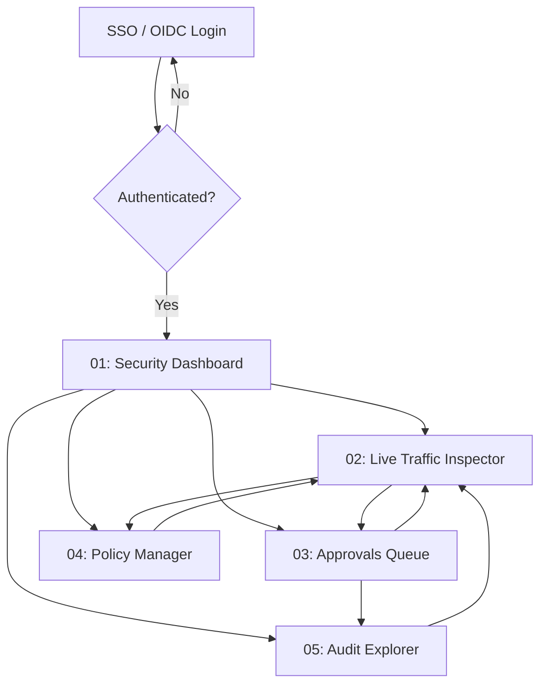

# Screens & Navigation Map

## Screen Inventory

| # | Screen Name | File | Route / Path | Platform | Related Features |
|---|---|---|---|---|---|
| 1 | Security Dashboard | [01-dashboard](screens/01-dashboard.md) | `/dashboard` | Web | [FEAT-008](features/FEAT-008.md), [FEAT-010](features/FEAT-010.md) |
| 2 | Live Traffic Inspector | [02-live-inspector](screens/02-live-inspector.md) | `/inspector` | Web | [FEAT-001](features/FEAT-001.md), [FEAT-004](features/FEAT-004.md), [FEAT-005](features/FEAT-005.md), [FEAT-008](features/FEAT-008.md) |
| 3 | Approvals Queue | [03-approvals-queue](screens/03-approvals-queue.md) | `/approvals` | Web | [FEAT-006](features/FEAT-006.md), [FEAT-008](features/FEAT-008.md) |
| 4 | Policy Manager | [04-policy-manager](screens/04-policy-manager.md) | `/policies` | Web | [FEAT-002](features/FEAT-002.md), [FEAT-012](features/FEAT-012.md) |
| 5 | Audit Explorer | [05-audit-explorer](screens/05-audit-explorer.md) | `/audit` | Web | [FEAT-007](features/FEAT-007.md), [FEAT-011](features/FEAT-011.md) |

---

## Navigation Map

---

## Shared / Common Components

### Empty State
Used on: Security Dashboard, Live Traffic Inspector, Approvals Queue, Audit Explorer
- Centered status container with subtle rounded border (`radius-lg`).
- Icon: 48x48px outline icon styled with `grey-400` ink token.
- Title: Semibold 18px (`h3`) heading in `text-primary`.
- Subtitle: Contextual helper text in `text-secondary` describing why the view is empty.
- Primary Action CTA: Optional button guiding the administrator to next steps (e.g. "Reset Active Filters" or "Test Policy Rule").

### Error State
Used on: all screens during API network failure or telemetry disconnect
- Alert panel styled with `error-100` background and `error-300` border.
- Leading icon: 24x24px alert triangle in `error-500`.
- Text: Brief plain-language description of error condition (e.g. "Unable to connect to gateway telemetry stream").
- Action: "Retry Connection" button triggering immediate background refresh.

### Security Status Pill
Used on: Live Traffic Inspector, Approvals Queue, Audit Explorer
- Compact badge with `radius-full` container and semibold 12px monospace text.
- Variants:
  - **Allowed:** `success-100` background, `success-900` text, checkmark icon.
  - **Blocked:** `error-100` background, `error-900` text, shield-ban icon.
  - **Pending HITL:** `warning-100` background, `warning-900` text, clock icon with countdown.
  - **Quarantined:** `error-900` background, `#FFFFFF` text, emergency stop icon.

### JSON Payload Viewer
Used on: Live Traffic Inspector, Policy Manager, Approvals Queue
- Dark syntax-highlighted code block using `JetBrains Mono` font ([branding](branding.md)).
- Inline secret redaction markers highlighted with high-contrast badge pill.
- One-click "Copy JSON" and "Format Payload" action buttons in header.
