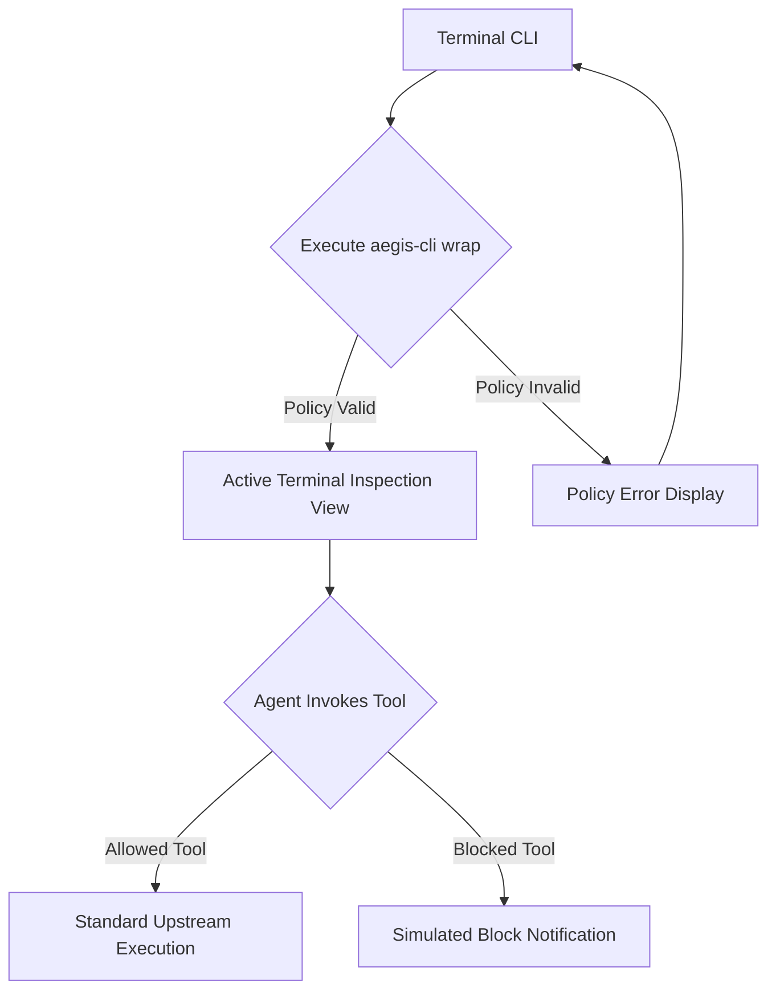
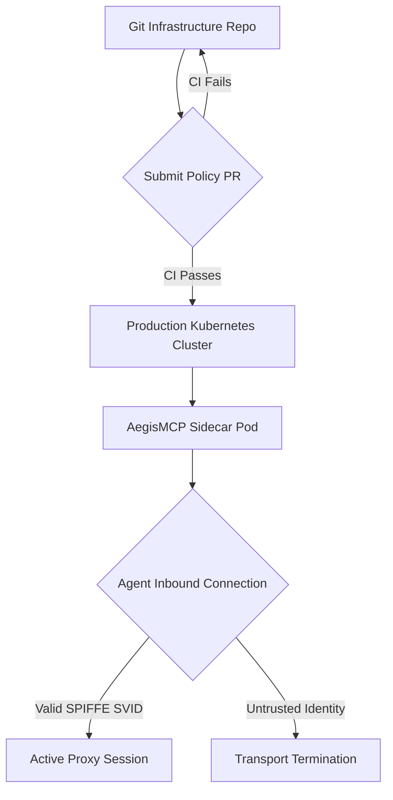
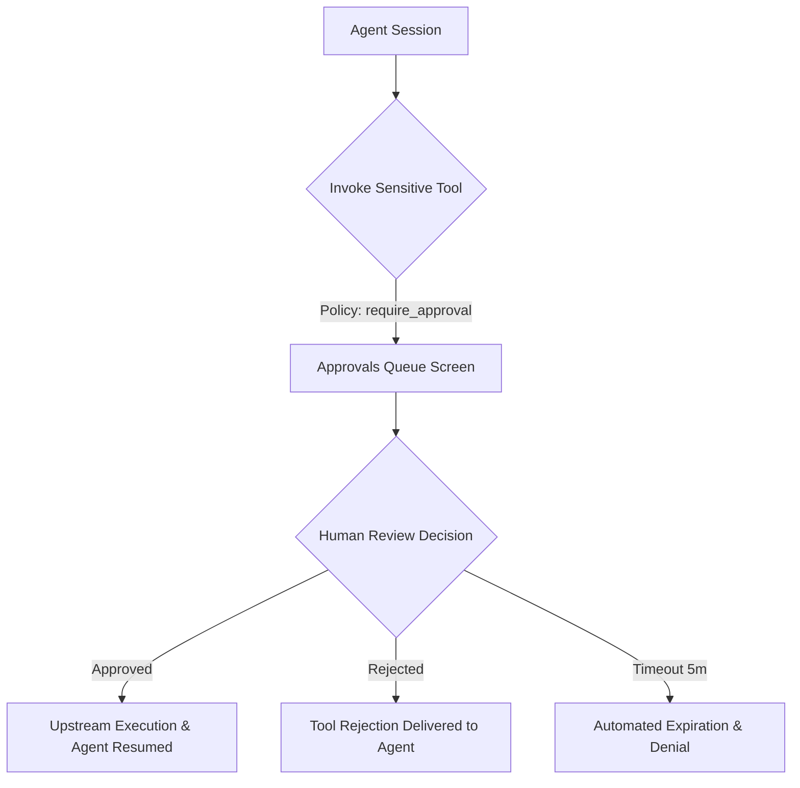
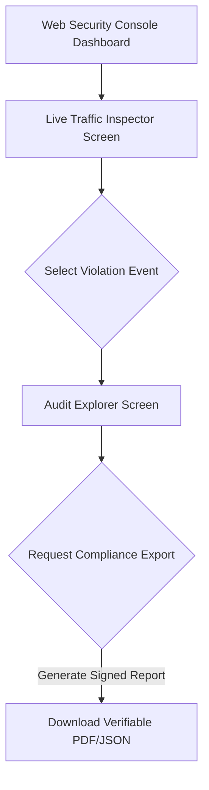

# User Journeys & Flows

## Flow Inventory

| # | Flow Name | Persona | Entry Point | Outcome | Related Features |
|---|---|---|---|---|---|
| 1 | Local Developer Wrapping & Debugging | David Chen | Terminal command (`aegis-cli wrap`) | Local agent connected to MCP server with live inspection and policy enforcement | [FEAT-001](features/FEAT-001.md), [FEAT-002](features/FEAT-002.md), [FEAT-003](features/FEAT-003.md) |
| 2 | Kubernetes Sidecar Deployment & GitOps Sync | Marcus Vance | Git commit to infrastructure repo or Helm chart | Transparent sidecar proxy deployed enforcing verified SPIFFE agent policies | [FEAT-001](features/FEAT-001.md), [FEAT-002](features/FEAT-002.md), [FEAT-009](features/FEAT-009.md), [FEAT-010](features/FEAT-010.md) |
| 3 | Human-in-the-Loop Tool Interception & Approval | Elena Rostova | High-risk agent tool call trigger | Sensitive action paused, routed to Slack/Web console, and authorized or rejected | [FEAT-001](features/FEAT-001.md), [FEAT-002](features/FEAT-002.md), [FEAT-006](features/FEAT-006.md), [FEAT-008](features/FEAT-008.md) |
| 4 | Incident Investigation & Compliance Audit Export | Elena Rostova | Web Security Console alert or audit review | Violation provenance verified and signed EU AI Act / SOC 2 compliance report exported | [FEAT-004](features/FEAT-004.md), [FEAT-007](features/FEAT-007.md), [FEAT-008](features/FEAT-008.md), [FEAT-011](features/FEAT-011.md) |

---

## Flow 1: Local Developer Wrapping & Debugging

**Persona:** David Chen (Senior AI Applications Engineer)
**Entry Point:** Terminal CLI (`aegis-cli wrap --policy ./aegis.yaml -- <mcp-command>`)
**Outcome:** Local agent client communicates with target MCP server through AegisMCP; tool calls are evaluated against policy rules, sanitized, and inspected in real time.

### Diagram

### Walkthrough

**Happy Path:**
1. David is developing an autonomous coding agent on his local machine and needs to test a filesystem MCP server without risking system file access.
2. David writes a declarative `aegis.yaml` restricting paths to `/workspace` and disallowing shell execution.
3. David runs `aegis-cli wrap --policy ./aegis.yaml -- npx @modelcontextprotocol/server-filesystem /workspace` in his terminal.
4. AegisMCP lints the policy, spawns the filesystem MCP server as a managed child process, and binds to the agent's stdio stream.
5. David triggers the agent to read `/workspace/package.json`.
6. AegisMCP parses the JSON-RPC request, verifies that the path matches the whitelist policy, and forwards the call upstream.
7. The upstream server returns the file contents. Outbound secret scrubbing scans the response (confirming zero leaked credentials).
8. The result returns to the agent in under 2ms.
9. David's terminal displays a green formatted log line: `[ALLOW] tools/call filesystem:read_file path="/workspace/package.json" (1.4ms)`.

**Alternate Path A — Policy Violation Interception:**
- At step 5, the agent attempts to read `/etc/passwd`.
- AegisMCP detects an out-of-bounds path violation.
- The call is immediately terminated locally with a JSON-RPC `-32001 Policy Violation` error without invoking the child MCP process.
- David's terminal highlights a red violation log: `[BLOCKED] tools/call filesystem:read_file path="/etc/passwd" -> Rule: path_whitelist_violation`.

**Alternate Path B — Policy File Syntax Error:**
- At step 3, if `aegis.yaml` contains invalid YAML or an unsupported rule keyword:
- The CLI aborts process launch, displays the exact line and character position of the syntax error, and exits with code 1 without spawning orphan child processes.

### States & Overlays Referenced

| Screen or Overlay | States |
|---|---|
| Terminal Inspection View | Initializing, Streaming Live Logs, Paused, Terminated |
| Local Violation Notice | Rendered inline in terminal |

---

## Flow 2: Kubernetes Sidecar Deployment & GitOps Sync

**Persona:** Marcus Vance (Staff Platform Engineer)
**Entry Point:** Infrastructure Git repository pull request
**Outcome:** AegisMCP sidecar container is deployed across Kubernetes worker pods, automatically authenticating agent workloads via SPIFFE/SPIRE and enforcing cluster-wide security policies.

### Diagram

### Walkthrough

**Happy Path:**
1. Marcus defines a team-wide security policy governing staging database MCP tools and commits the YAML file to the platform Git repository.
2. The CI pipeline validates the policy syntax via automated tests.
3. ArgoCD detects the merged commit and applies the updated Helm chart to the Kubernetes cluster.
4. The AegisMCP sidecar container launches inside the AI agent pod and mounts the SPIFFE Workload API Unix socket.
5. The autonomous agent initiates a mutual TLS (mTLS) connection to `localhost:8443`.
6. AegisMCP verifies the agent's x509 SVID certificate chain, extracts its SPIFFE identity (`spiffe://cluster.local/ns/agents/sa/lead-worker`), and binds the session.
7. The agent sends tool requests, which execute within the enforced policy boundaries with sub-5ms P99 latency.

**Alternate Path A — Untrusted Agent Identity:**
- At step 6, a misconfigured or unapproved container attempts to connect to the sidecar proxy without a valid SVID certificate.
- AegisMCP terminates the TLS handshake immediately with an untrusted client error and records a security incident alert.

**Alternate Path B — Emergency Kill-Switch Activated:**
- While the agent pod is running, Marcus detects anomalous behavior and runs `kubectl exec -it <pod> -c aegis-sidecar -- aegis-cli kill --all`.
- AegisMCP severs all active JSON-RPC streaming sockets immediately and rejects any new connection attempts until reset.

### States & Overlays Referenced

| Screen or Overlay | States |
|---|---|
| Kubernetes Pod / Sidecar | Starting, SVID Bound, Running, Quarantined, Draining |
| Emergency Lockdown Banner | Active across all telemetry channels |

---

## Flow 3: Human-in-the-Loop Tool Interception & Approval

**Persona:** Elena Rostova (Lead DevSecOps Engineer)
**Entry Point:** High-impact tool invocation by an autonomous agent (e.g. database table mutation, financial transaction)
**Outcome:** Sensitive action is suspended in gateway memory, notified out-of-band to Slack and the Web Console Approvals Queue, and either authorized or rejected by a human.

### Diagram

### Walkthrough

**Happy Path:**
1. An autonomous support agent processes a customer request and determines it needs to issue a $120 invoice credit via an MCP billing tool.
2. The agent sends `tools/call billing:issue_credit amount=120 customer_id=cust_9812`.
3. AegisMCP evaluates policy: `billing:issue_credit` has `require_approval: true` for amounts exceeding $50.
4. AegisMCP suspends the JSON-RPC request without disconnecting the agent, creates a unique approval ticket, and starts a 5-minute countdown timer.
5. AegisMCP dispatches an interactive Slack notification to `#secops-approvals` and pushes the ticket to the Web Admin Console Approvals Queue screen.
6. Elena views the notification in Slack, reviewing the agent identity, customer ID, requested amount, and prompt justification.
7. Elena clicks the interactive "Approve" button.
8. AegisMCP verifies Elena's authorization, releases the suspended call to the billing MCP server, records Elena's approval in the tamper-evident audit ledger, and returns the success response to the waiting agent.

**Alternate Path A — Human Rejects Action:**
- At step 7, Elena recognizes an abnormal transaction pattern and clicks "Reject" with the note "Unjustified credit request."
- AegisMCP cancels the pending call, returns a JSON-RPC `-32002 Approval Denied` error to the agent, and marks the session for monitoring.

**Alternate Path B — Timeout Without Human Action:**
- At step 4, if neither Slack nor the Web Console records a response within 300 seconds (5 minutes):
- AegisMCP fails closed: the approval ticket expires, the agent receives an `APPROVAL_TIMEOUT` error, and an expiration warning is logged.

### States & Overlays Referenced

| Screen or Overlay | States |
|---|---|
| Approvals Queue Screen | Empty, Pending Items, Reviewing Item, Action Submitted |
| Slack Interactive Card | Pending, Approved, Rejected, Expired |
| Action Rejection Modal (Overlay) | Default, Submitting Rejection Note |

---

## Flow 4: Incident Investigation & Compliance Audit Export

**Persona:** Elena Rostova (DevSecOps Lead) / Priya Sharma (CISO)
**Entry Point:** Web Security Console alert banner or scheduled audit preparation
**Outcome:** Security team traces prompt injection provenance, reviews cryptographic ledger integrity, and exports signed compliance attestations for external auditors.

### Diagram

### Walkthrough

**Happy Path:**
1. Elena logs into the AegisMCP Web Security Console via enterprise Single Sign-On (SSO).
2. The Dashboard displays an active security violation alert: "Indirect Prompt Injection & Tool-Chaining Blocked."
3. Elena clicks the alert and navigates to the Live Traffic Inspector Screen.
4. Elena inspects the flagged agent session: the agent read an external untrusted customer document, followed immediately by an attempt to call `curl:post` with internal environment variables.
5. Elena navigates to the Audit Explorer Screen to view the complete immutable audit trail for that agent.
6. Elena clicks "Export Compliance Attestation", selecting the EU AI Act (Article 12 & 14) and SOC 2 Type II report template.
7. The system queries the append-only ledger, validates SHA-256 hash-chain integrity, appends digital signatures, and generates a downloadable report package.
8. Elena downloads the cryptographically sealed report and forwards it to Priya Sharma for regulatory filing.

**Alternate Path A — Hash Chain Integrity Check Discrepancy:**
- At step 7, if any historical record in the query range fails cryptographic hash verification:
- The system immediately halts report export, triggers a critical security incident alert on the dashboard, and identifies the exact compromised block index for forensics.

### States & Overlays Referenced

| Screen or Overlay | States |
|---|---|
| Dashboard Screen | Normal, High Alert, Degraded Connectivity |
| Live Traffic Inspector Screen | Streaming, Paused, Filtering Active, Item Expanded |
| Audit Explorer Screen | Querying, Loaded Records, Empty Search Results |
| Compliance Export Modal (Overlay) | Selecting Parameters, Generating Hashes, Ready for Download |

---

## Global Flows

### Authentication Gate
- Any unauthenticated attempt to access the Web Management Console redirects to the enterprise SSO/OIDC login portal.
- After successful IdP authentication, the administrator is redirected back to their originally requested screen route.
- An inactive admin session expires after 15 minutes of idle time ([NFR-029](nfr.md)), displaying a re-authentication modal that preserves any in-progress policy draft.

### Transport & Network Error Recovery
- If the browser loses Server-Sent Events (SSE) connectivity to the Live Traffic Inspector, an inline status banner displays "Reconnecting..." and attempts automatic reconnection with exponential backoff without reloading the page.
- In-flight human approval requests are resiliently re-synced from the server upon reconnection to prevent orphaned approval states.
